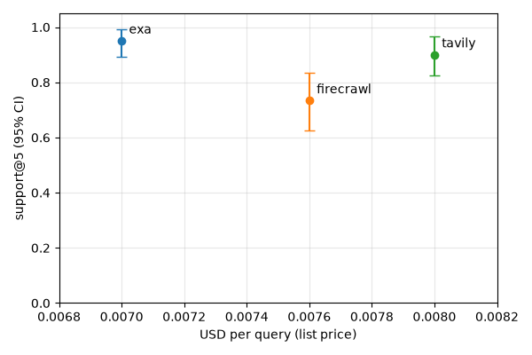

# searchbench report: 2026-11-19_1b8ce7b

> **Warning: judge agreement with human labels is below 0.6 (kappa = 0.28).** Treat support@5 differences as provisional. See Judge validation.

60 tasks, 3 vendors, k = 5, content cut to 2000 characters. Primary judge `gemini-3.1-pro-preview`, second judge `gemini-3.5-flash-lite`. 95% CIs by bootstrap over tasks.

## Headline

| vendor | support@5 | domain_hit@5 | cited rank (n) | p50 ms | p95 ms | USD / query | error rate | median chars |
|---|---|---|---|---|---|---|---|---|
| exa | 0.95 [0.89, 0.99] | 0.90 [0.82, 0.97] | 1.93 (58) | 1461 | 2083 | 0.0070 | 0.0% | 554 |
| firecrawl | 0.73 [0.62, 0.83] | 0.82 [0.72, 0.92] | 2.31 (48) | 1968 | 4038 | 0.0076 | 0.0% | 156 |
| tavily | 0.90 [0.82, 0.97] | 0.78 [0.67, 0.88] | 1.64 (55) | 1629 | 3214 | 0.0080 | 0.0% | 1188 |

## Pairwise support@5 (paired bootstrap)

| comparison | difference | verdict |
|---|---|---|
| exa - firecrawl | 0.22 [0.12, 0.33] | significant |
| exa - tavily | 0.05 [-0.03, 0.13] | too close to call |
| firecrawl - tavily | -0.17 [-0.27, -0.08] | significant |

With 60 tasks, a difference is called significant only when its 95% CI excludes 0. Rows marked too close to call cannot be resolved by this suite.

## support@5 by category

| category | exa | firecrawl | tavily |
|---|---|---|---|
| factual | 1.00 [1.00, 1.00] | 0.75 [0.50, 1.00] | 0.92 [0.75, 1.00] |
| technical_docs | 1.00 [1.00, 1.00] | 0.83 [0.58, 1.00] | 0.92 [0.75, 1.00] |
| fresh | 1.00 [1.00, 1.00] | 0.79 [0.58, 1.00] | 1.00 [1.00, 1.00] |
| multi_hop | 0.92 [0.79, 1.00] | 0.54 [0.38, 0.71] | 0.67 [0.42, 0.88] |
| long_tail | 0.83 [0.58, 1.00] | 0.75 [0.50, 1.00] | 1.00 [1.00, 1.00] |

Each cell has at most 12 tasks, so these intervals are wide. Changes in `fresh` can reflect the world changing, not only the vendor.

## Judge validation

| comparison | n | Cohen's kappa | raw agreement |
|---|---|---|---|
| gemini-3.1-pro-preview vs human | 40 | 0.28 | 85% |
| gemini-3.5-flash-lite vs human | 40 | 0.37 | 82% |
| gemini-3.1-pro-preview vs gemini-3.5-flash-lite | 180 | 0.50 | 83% |

Human labels: 40 pairs, stratified by category, 92% labelled yes. When one label dominates, chance agreement is high and kappa stays low even with high raw agreement, so both are shown.

| judge | quotes not found in the cited result | hallucination rate |
|---|---|---|
| gemini-3.1-pro-preview | 6 of 167 | 3.6% |
| gemini-3.5-flash-lite | 20 of 166 | 12.0% |

A yes or partial verdict counts only if its quote appears verbatim in the title or text of the result it cites; otherwise it is scored as no.

Order bias: 3 of 30 sampled pairs (10%) changed verdict when the results were shown in reverse order to `gemini-3.1-pro-preview`.

## Threats to validity

- 60 tasks is small: most differences between vendors are within noise.
- One judge family: Gemini judges results that may include Google-indexed content.
- Gold answers can go stale; each task records the date it was verified (`as_of`).
- Free-tier access may differ from paid tiers in ranking, freshness or latency.
- Content is cut to 2000 characters, and each vendor is judged on its default output: vendors that return short snippets give the judge less text to quote (see median chars).
- Cited rank is the result the judge quoted, which is not always the first result that supports the answer.
- The primary judge is a thinking model whose wording can change between runs; judgments are read from the committed cache, never re-run.
- One snapshot in time: results change as indexes and the web change.
